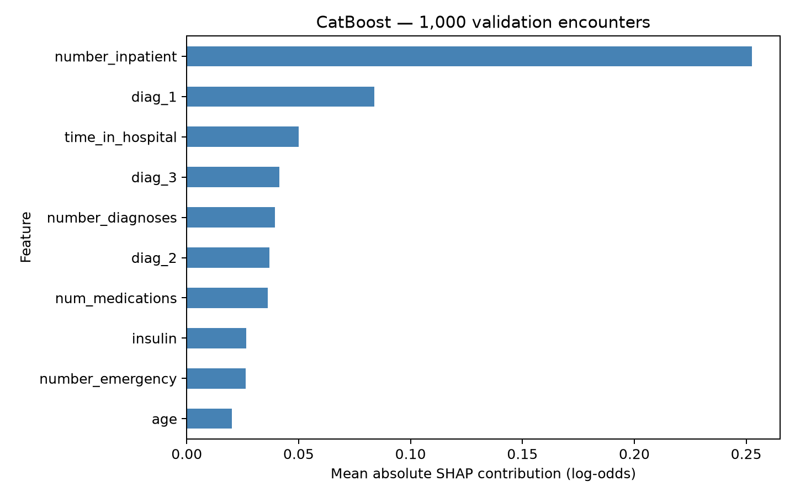
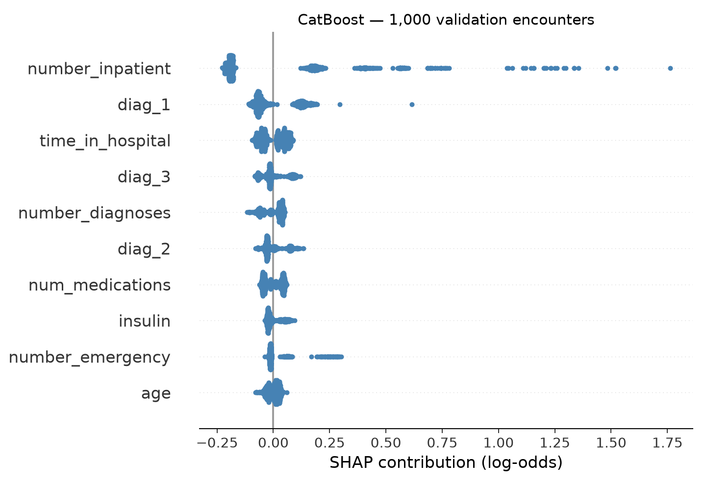

# Model Audit Report — XAI checkpoint

Date: 2026-11-20. Phase 3 remains in progress. This checkpoint documents
explanations of the current model; broader subgroup uncertainty and the final
integrated audit remain pending. This educational project is not a clinical tool.

## Model and evaluation boundary

The explained model is the training-fitted **CatBoost with 41 predictors**
(`reviewed`), with native categorical handling and training-fitted mode
imputation for `medical_specialty`. See the [predictor review](FEATURE_REVIEW.md)
and [audit protocol](MODEL_AUDIT_PLAN.md). Identifiers are never predictors.

We explained 1,000 encounters randomly sampled without replacement from the
19,883-encounter development-validation partition, using seed `42`. This
partition has already been inspected repeatedly; it is not external validation.
The final test was not scored. Sampling is by encounter, so patients with more
encounters can contribute more observations.

## SHAP method and integrity

Contributions come from CatBoost's native `ShapValues`, using the exact fitted
preprocessing output and its ordered feature names. The separate `shap` package
is used for visualization, not model fitting or a replacement explanation
algorithm. No explicit background dataset was supplied to the native method.

For each explained encounter, the native reference plus all signed contributions
must reconstruct the raw binary-model score. Applying the sigmoid to that score
must reproduce the pipeline probability. The implementation checks feature order,
matrix shape, finite values and both reconstruction identities (`rtol=1e-6`,
`atol=1e-8`). These checks establish numerical consistency, not calibration.

The reference and all contributions are in **raw log-odds**. Individual
contributions are not probability differences, and their sigmoid transforms
must not be added. The reference is the native explanation baseline, not the
mean probability of the displayed sample.

## Global and local interpretation

`number_inpatient` had the highest mean absolute SHAP contribution in the seed
`42` sample (`0.252509` log-odds). This indicates that the number of inpatient
encounters recorded during the preceding year was the strongest contributor,
on average, among the included features for these predictions. It is not a
claim that this variable causes readmission or is universally most important.

The bar plot summarizes mean absolute contributions. The beeswarm also displays
their signs and distributions across individual encounters. It uses a single
color: nominal diagnosis and medication categories must not be presented as
having a numeric low-to-high ordering.





The local waterfall uses the first encounter of the fixed sampled sequence,
chosen independently of its outcome or explanation. It starts at the native
reference and retains all signed contributions; features outside the leading
display rows are grouped into a residual sum. The exported metadata records
the sample-row position, and the local identifier table links that position to
the encounter. These patient-level artifacts remain local and are not published.
Positive contributions increase the model score; they do not establish causal
effects or justify treatment changes.

## Descriptive sensitivity to sampling

With the fitted model fixed, we repeated the global summary on two additional
samples of 1,000 validation encounters, using seeds `7` and `123`. Overlap
between samples was allowed. All three samples had the same ten leading
features. The first seven retained their ordering; `insulin` and
`number_emergency` exchanged eighth and ninth positions, while `age` remained
tenth.

| Seed | Mean absolute contribution of `number_inpatient` (log-odds) |
| --- | ---: |
| `42` | `0.252509` |
| `7` | `0.246739` |
| `123` | `0.248820` |

The [complete 41-feature comparison](reports/shap_sampling_stability.csv)
preserves unrounded values and aligns features by name, not ranking position.
This suggests limited sensitivity of the leading-feature summary to these
three sampling choices, conditional on this model and validation partition.
The minimum and maximum across three samples are **not a 95% confidence
interval**. This does not measure uncertainty from refitting, feature selection,
or population changes.

Provenance boundary: the seed `42` column was checked against the archived native
contributions. Seeds `7` and `123` were calculated in the learner's console and
exported as complete Series; their full contribution matrices, sample identifiers
and execution environments were not archived, and those runs were not
independently recomputed. Local metadata records this limitation and fingerprints
the comparison CSV and reference artifacts.

## Reproduction and remaining limitations

After following the [current training workflow](../README.md), export all three
plots and their underlying checked explanations to a new directory:

```bash
MPLBACKEND=Agg .venv/bin/python -m scripts.explain_model --output-dir artifacts/explanations
```

`Agg` renders files without opening GUI windows. The command refuses an existing
destination and saves CSV/NPZ data, three PNGs and metadata with source, split,
model, code and output hashes. Public global figures are snapshots from the
recorded seed `42` run; rendering bytes may differ across library versions.
The sampling-sensitivity comparison was a console exercise, not an automated
study command.

SHAP describes the fitted model, not causal effects, calibrated probabilities,
clinical utility or fairness. Dependence between predictors can affect attribution.
Global absolute means discard direction; low importance alone does not justify
removing a variable. A single local explanation cannot characterize the whole
model. Historical data selection, missingness, incomplete outcome capture and
uncertain feature-availability timestamps further limit interpretation.

The [audit plan](MODEL_AUDIT_PLAN.md) defines subgroup/threshold and calibration
assessment separately. Neither numerical SHAP reconstruction nor this sampling
exercise establishes that the system is fair or suitable for clinical use.

Method references: [CatBoost SHAP values](https://catboost.ai/docs/en/concepts/shap-values),
[SHAP beeswarm](https://shap.readthedocs.io/en/latest/generated/shap.plots.beeswarm.html)
and [SHAP waterfall](https://shap.readthedocs.io/en/latest/generated/shap.plots.waterfall.html).
