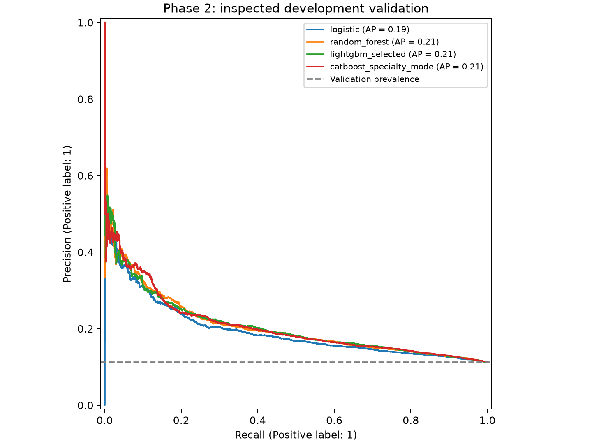
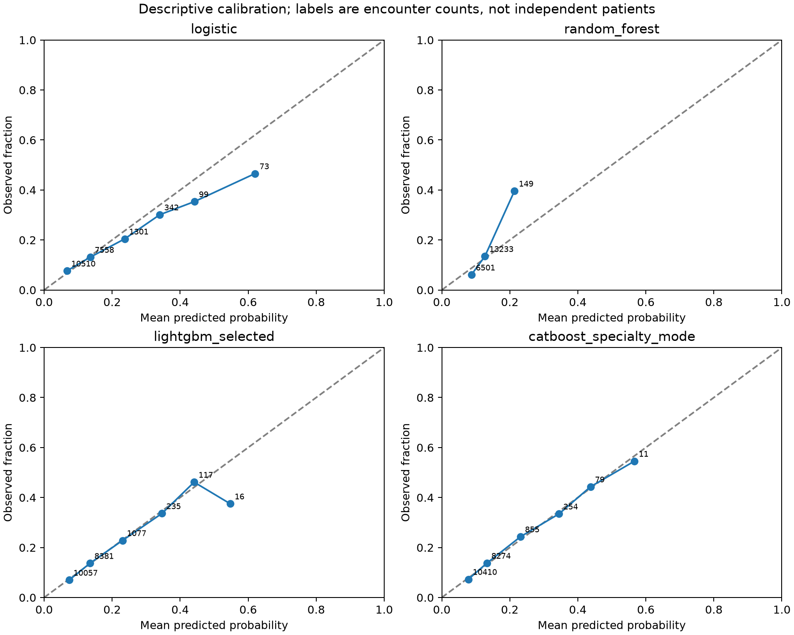

# Phase 2 — frozen development comparison

Completed: 2026-11-12. This is an educational retrospective modeling milestone,
not a clinical validation or a final-test performance claim. The final test has
not been predicted or scored. Earlier exploratory results remain in
[BASELINE_REPORT.md](BASELINE_REPORT.md).

## Question and protocol

Predict recorded readmission category `<30` versus `>30`/`NO` at a nominal
discharge-time prediction point. One row is an encounter, not an independent
patient. Keep `patient_nbr` for grouping and `encounter_id` for integrity; neither
is predictive. Exclude discharge codes `11`, `19`, `20`, `21` from the analysis
cohort, preserving the full raw source. Source: UCI Diabetes 130-US Hospitals,
1999–2008, [dataset DOI](https://doi.org/10.24432/C5230J), CC BY 4.0.

| Partition | Encounters | Patients | Positives |
| --- | ---: | ---: | ---: |
| Training | 60,276 | 42,263 | 6,925 |
| Development validation | 19,883 | 14,088 | 2,233 |
| Reserved test | 19,955 | 14,088 | 2,199 |

Test counts are split-support audits, not model evaluation. Patient sets are
disjoint. Five shuffled GroupKFold splits (seed 42) within saved training support
selection; learned preprocessing fits within each fold. Development validation
has been examined repeatedly, so it is not an untouched confirmatory sample.
Earlier source-level descriptive audits also used the complete source; do not
describe the whole study as prospectively preregistered or externally validated.

## Procedures fixed before the closing evaluation

All use the same 45 selected source predictors: eight numerical and 37
categorical. Weight is excluded; discharge disposition is a cohort field, not a
predictor. Diagnosis availability at prediction time remains an assumption.

| Procedure | Numerical/categorical handling | Fixed classifier settings |
| --- | --- | --- |
| Logistic | StandardScaler / one-hot | C=1, lbfgs, max_iter=1000 |
| Random Forest | Raw numerical / one-hot | 200 trees, min_samples_leaf=20, seed 42 |
| Selected LightGBM | Raw numerical / one-hot | 200 rounds, rate .05, 15 leaves, min_child_samples=100, L2=10, seed 42 |
| Selected CatBoost | Raw numerical / native categories; specialty mode only | 200 rounds, rate .05, depth 6, L2=3, seed 42 |
| Dummy | Training prior | One constant probability |

Eight LightGBM settings were compared on the same training folds. The selected
configuration had mean fold AP 0.209942. Seven CatBoost missingness profiles were
compared: explicit markers, specialty/race/payer modes individually, specialty
mode plus an indicator, and three-/six-column mode groups. Specialty-only mode
without indicator had the highest observed mean AP, 0.212184. The two final
grouped imputations scored 0.211301 and 0.211012; imputing more fields did not
improve the observed ranking metric. Lab `None` remains a nonmeasurement category;
other unavailable administrative codes retain their semantics. Imputed categories
are modeling substitutions, not verified true values.

Selection uses training-CV mean AP, not the following validation scores. Search
budgets differ, and selected CV scores are optimistic after selection. Procedures
were frozen before the closing evaluation; no further model or imputation search
is part of this phase.

## Closing development-validation results

Each procedure was fitted on all 60,276 training encounters only, then evaluated
on the same 19,883 validation encounters. Positive prevalence is 11.2307%.

| Model | AP | AUROC | Brier |
| --- | ---: | ---: | ---: |
| Logistic | 0.193949 | 0.636235 | 0.097040 |
| Random Forest | 0.205396 | 0.652105 | 0.097238 |
| Selected LightGBM | 0.205340 | 0.654017 | 0.096050 |
| Selected CatBoost | 0.205999 | 0.653226 | 0.096056 |
| Dummy | 0.112307 | 0.500000 | 0.099701 |

CatBoost is retained because of the training selection rule, not a claim that
its small validation AP lead establishes superiority. LightGBM's slightly lower
Brier and higher AUROC do not establish a different universal winner either.

AP and trapezoidal PR area are distinct: selected CatBoost's latter is 0.205659.
The CSV also records the constant dummy's trapezoidal area, 0.556153, arising
from interpolation to the conventional endpoint; this is not its AP or the
appropriate constant-ranking baseline. Dummy AP equals validation prevalence.



## Conditional uncertainty

Use 1,000 patient-cluster bootstrap replicates (seed 123), resampling each selected
patient with all their encounters, retaining repeated draws. Every model uses
the same positions within a replicate. These individual 95% percentile intervals
condition on fitted models and the inspected validation sample; they exclude
training and selection variability and are not simultaneous confidence bands.

Selected CatBoost marginal intervals:

| Metric | Point | 95% percentile interval |
| --- | ---: | --- |
| AP | 0.205999 | [0.188982, 0.227624] |
| AUROC | 0.653226 | [0.638894, 0.666571] |
| Brier | 0.096056 | [0.092371, 0.100312] |

Selected paired differences, consistently **CatBoost minus comparator**:

| Comparator | Metric | Difference | 95% percentile interval |
| --- | --- | ---: | --- |
| Logistic | AP | +0.012051 | [+0.004833, +0.018542] |
| RF | AP | +0.000604 | [-0.005119, +0.006035] |
| LightGBM | AP | +0.000659 | [-0.003973, +0.005275] |
| RF | Brier | -0.001182 | [-0.001759, -0.000707] |
| LightGBM | Brier | +0.000006 | [-0.000204, +0.000217] |

Direction is unresolved for AP versus RF/LightGBM and Brier versus LightGBM;
crossing zero is not equivalence. The conditional comparisons favor CatBoost
over logistic for AP and over RF for Brier, subject to the development/selection
limitations above. Full marginal and paired results are exported as aggregate
[intervals](reports/phase2_validation_intervals.csv) and
[paired intervals](reports/phase2_paired_intervals.csv).

## Calibration and practical limits

The following fixed-bin summaries describe probabilities; no recalibration was
fitted. Point labels are encounter counts. Patients may occur in several bins,
and bin membership differs across models. Connecting bin means is descriptive,
not a fitted calibration function or a confidence band.



CatBoost's largest bins have mean predictions/observed fractions 0.0781/0.0730
and 0.1327/0.1377. Its highest bin has only 11 encounters from seven distinct
patients: apparent closeness there is weak evidence. Brier combines calibration
and discrimination/resolution; a lower value alone is not proof of better
calibration. No operating threshold, staffing capacity or clinical utility was
established. Ranking metrics do not demonstrate treatment benefit.

Historical, selectively recorded data and incomplete readmission capture limit
transportability. Random patient-disjoint splitting is not temporal/prospective
validation. No reliable chronology establishes exact availability of all fields.
No causal, diagnostic, treatment or deployment claim is made.

## Reproduction and checks

From the project root, with the source CSV, prepared environment and verified
saved splits:

```bash
.venv/bin/python -m scripts.evaluate_final_models \
  --output-dir artifacts/phase2_validation_repeat --bootstrap 1000
```

The destination must not exist. This command fits four frozen procedures plus
the dummy, exports predictions/metrics/calibration, shared-patient bootstrap
tables, PR/calibration PNGs, selected fitted pipeline and fingerprints/version
metadata. The saved pipeline is fitted to training only, not to development or
test. It can be inspected in Phase 3 without changing this evaluation.

Reference run: artifacts/phase2_fixed_validation_2026-11-12. Reviewer executed
this closing command; all supports, three 1000-by-five bootstrap tables, calibration
totals and recorded hashes were checked. The exported selected pipeline was
reloaded and its validation probabilities matched the saved predictions. Both
figures were visually inspected. Code tests: 107 passing; pip check passes.
Only aggregate tables/figures are copied to docs/reports; patient-level data and
model files remain ignored by Git. A fresh-machine reconstruction and full
transitive dependency lock are not claimed.

The original six-feature example and intermediate three-model command are
learning references, not competing final entry points. Code license: MIT,
chosen by the learner; dataset license remains CC BY 4.0. No commit, push or
publication was performed. Next phase: explanation of the fixed model and
experiment tracking, with final-test isolation maintained.
